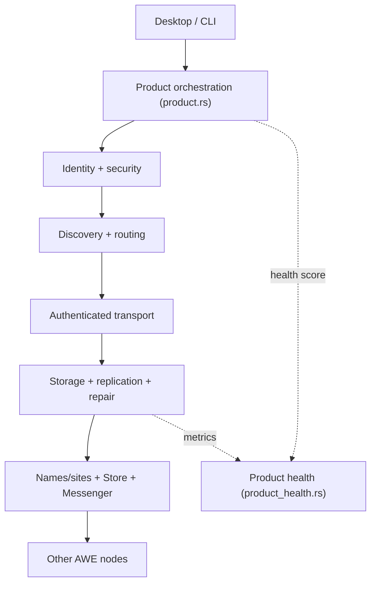

<div align="center">

# AWEp2P

**The decentralized networking and resource layer of the AWE ecosystem.**

Identity · Secure transport · Discovery · Routing · Distributed storage ·
Names/Sites · Store · Messenger · Desktop clients · Product orchestration

[](https://github.com/ARARAT33/AWENET/actions/workflows/core.yml)
[](https://github.com/ARARAT33/AWENET/actions/workflows/cross-platform.yml)
[](https://github.com/ARARAT33/AWENET/actions/workflows/format.yml)
[](https://github.com/ARARAT33/AWENET/actions/workflows/security-audit.yml)
[](LICENSE)
[](https://www.rust-lang.org)

*aweone.pages.dev*

</div>

---

## What AWEp2P is

AWEp2P keeps the full architecture of a sovereign peer-to-peer network —
identity, secure transport, discovery, routing, distributed storage with
replication and repair, names/sites, Store, Messenger and desktop clients —
while exposing a small, stable product orchestration model on top.

| Layer | Modules (examples) | What it gives you |
| --- | --- | --- |
| Product orchestration | `product`, `product_health`, `readiness` | One stable model for resources, peers, placement, transfers, capacity, health score |
| Identity & security | `identity`, `security`, `crypto`, `defense`, `sandbox` | Ed25519 identity, authenticated encrypted transport, hostile-traffic limits |
| Discovery & routing | `discovery`, `routing`, `network_topology`, `lan_mesh` | DHT-style lookup, Data Centre topology, relay failover, LAN mesh |
| Data plane | `data_plane`, `storage`, `replication`, `repair`, `recovery` | Chunked content-addressed storage, replica placement, repair planning |
| Names, Store, Messenger | `namespace`, `host`, `store`, `messenger` | AWEwww/AWETLD names, hosted sites, Store, Messenger |
| Economy (ONECOIN) | `onecoin*`, `onebank`, `governance` | Distributed finality, payments, wallets, governance |

## Product architecture

The product facade is in `core/src/product.rs`. It gives the existing
subsystems one stable model for resources, peers, placement, transfers,
capacity and product health. It does not replace the deeper protocol modules.



## Quickstart

```bash
# Linux / macOS — one command
curl -fsSL https://raw.githubusercontent.com/ARARAT33/AWENET/main/awenet.sh | sh

# Windows
awenet.cmd
```

From source:

```bash
git clone https://github.com/ARARAT33/AWENET.git
cd AWENET
cargo build --release
cargo run --release
```

## Build and test

```bash
cargo fmt --all -- --check
cargo test --workspace
cargo clippy --workspace --all-targets -- -D warnings
```

CI runs the same commands on every push; a green check means the workspace
is formatted, tested and clippy-clean.

## The AWENET desktop product

`awe-node` starts the complete local product: a Rust node with an embedded
desktop-style UI served from `127.0.0.1:41800`.

- Home dashboard with live node state, topology map and known peers
- Browser for `awe://` resources and the web
- Messenger with realtime voice/video calls, groups and channels
- Storage, AWEStore and the ONECOIN economy screens
- **Light & dark themes** — auto-detected from your OS, manually switchable
- **Command palette** — press `Ctrl+K` to jump to any screen or action
- Keyboard shortcuts: `Alt+1…9` switch screens, `Alt+/` shows the shortcut hint

## Product health score

`core/src/product_health.rs` aggregates replica durability, peer coverage,
transfer success and DHT responsiveness into a single 0–100 score with a
stable band (Critical / AtRisk / Stable / Excellent) and a concrete
recommendation. A bounded rolling history gives operators a trend, not just a
snapshot. See [docs/HEALTH-SCORE.md](docs/HEALTH-SCORE.md).

## Important status rule

A source module or UI screen is not proof of end-to-end functionality.
Production readiness requires evidence from independent nodes and clean-machine
release tests. For distributed validation, use
[docs/REAL-NETWORK-TEST.md](docs/REAL-NETWORK-TEST.md); the release acceptance
model is in [docs/PRODUCT-ARCHITECTURE.md](docs/PRODUCT-ARCHITECTURE.md) and
[docs/PRODUCT-READINESS-GATES.md](docs/PRODUCT-READINESS-GATES.md).

## Documentation

- [AWENET architecture](docs/AWENET-ARCHITECTURE.md)
- [Product architecture & release acceptance](docs/PRODUCT-ARCHITECTURE.md)
- [Readiness gates](docs/PRODUCT-READINESS-GATES.md)
- [Real-network test plan](docs/REAL-NETWORK-TEST.md)
- [Network topology](docs/network-topology.md)
- [Engineering charter](docs/AWEP2P-ENGINEERING-CHARTER.md)
- [Daily status](docs/AWEP2P-DAILY-STATUS.md)
- [Contributing](CONTRIBUTING.md)
- [Product roadmap](docs/ROADMAP.md)

## Security

Authenticated transport and cryptographic primitives protect different
threats. They do not by themselves provide anonymity. Never log secrets,
private keys or plaintext private content.

## License

MIT
