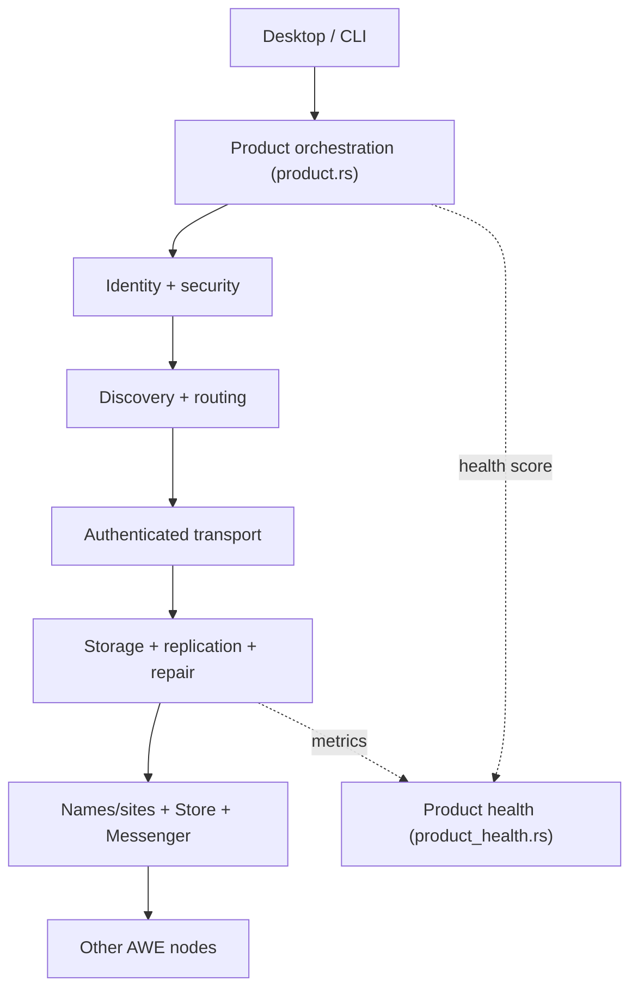

<div align="center">

# AWEp2P

**The decentralized networking and resource layer of the AWE ecosystem.**

Identity · Secure transport · Discovery · Routing · Distributed storage ·
Names/Sites · Store · Messenger · Desktop clients · Product orchestration

[](https://github.com/ARARAT33/AWENET/actions/workflows/core.yml)
[](https://github.com/ARARAT33/AWENET/actions/workflows/cross-platform.yml)
[](https://github.com/ARARAT33/AWENET/actions/workflows/format.yml)
[](https://github.com/ARARAT33/AWENET/actions/workflows/security-audit.yml)
[](LICENSE)
[](https://www.rust-lang.org)

*aweone.pages.dev*

</div>

---

## What AWEp2P is

AWEp2P keeps the full architecture of a sovereign peer-to-peer network —
identity, secure transport, discovery, routing, distributed storage with
replication and repair, names/sites, Store, Messenger and desktop clients —
while exposing a small, stable product orchestration model on top.

| Layer | Modules (examples) | What it gives you |
| --- | --- | --- |
| Product orchestration | `product`, `product_health`, `readiness` | One stable model for resources, peers, placement, transfers, capacity, health score |
| Observability & automation | `events`, `metrics`, `scheduler`, `search` | Bounded audit event log, counters/gauges/p95 latency samples, tick-driven maintenance jobs, local resource search |
| Node platform services | `alerts`, `backup`, `notifications`, `quota`, `i18n`, `update` | Threshold alerts, backup/restore planning, bounded notifications, quota accounting, bilingual (en/hy) UI strings, version & upgrade policy |
| Smart node services | `automation`, `ratelimit`, `firewall`, `cache` | Metric-driven automation with cooldowns and dry-run, keyed token-bucket limiting, prefix-based peer firewall, bounded LRU cache |
| Trust & lifecycle services | `sessions`, `consent`, `features`, `sync` | Authenticated sessions with tick TTL and revocation, consent ledger with expiry and audit log, deterministic feature flags, coordinator-free LWW state sync |
| Intelligence & resilience services | `insights`, `capacity`, `circuit`, `journal`, `archiver` | Rolling-window insights with anomaly detection, capacity forecasts with urgency bands, circuit breaker with cooldown, write-ahead journal with checkpoints, retention & compaction planning |
| Developer & API services | `tasks`, `keys`, `webhooks`, `runbooks` | Priority task queue with deadlines and retry budgets, scoped API keys with rotation and expiry, event webhooks with cooldowns and dead-lettering, gated runbooks with dry-run plans |
| Commerce & economy services | `accounting`, `billing`, `subscriptions`, `escrow` | Double-entry ledger with balanced entries, invoice lifecycle with payments and overdue sweeps, subscription lifecycle with trial and grace periods, escrow with fees, release and refund |
| AWENETwork & founder economy | `founder`, `awenetwork`, `resource_economy`, `price_control`, `treasury` | Founder-exclusive authority with an immutable audit log, founder-published work tasks with approve-then-pay rewards, consented resource contributions with reliability-weighted payouts, official price control with history, treasury issuance vs circulation accounting |
| Founder protection & economy completion | `founder_guard`, `resource_meter`, `store_escrow`, `fraud`, `rankings` | Passkey-protected founder step-up authorization, host resource metering with multi-verifier usage reports, store escrow orders over ONECOIN, advisory fraud detection with bounded evidence, contributor rankings and achievements that never mint |
| Identity & security | `identity`, `security`, `crypto`, `defense`, `sandbox` | Ed25519 identity, authenticated encrypted transport, hostile-traffic limits |
| Discovery & routing | `discovery`, `routing`, `network_topology`, `lan_mesh` | DHT-style lookup, Data Centre topology, relay failover, LAN mesh |
| Data plane | `data_plane`, `storage`, `replication`, `repair`, `recovery` | Chunked content-addressed storage, replica placement, repair planning |
| Names, Store, Messenger | `namespace`, `host`, `store`, `messenger` | AWEwww/AWETLD names, hosted sites, Store, Messenger |
| Economy (ONECOIN) | `onecoin*`, `onebank`, `governance` | Distributed finality, payments, wallets, governance |

## Product architecture

The product facade is in `core/src/product.rs`. It gives the existing
subsystems one stable model for resources, peers, placement, transfers,
capacity and product health. It does not replace the deeper protocol modules.



## Quickstart

```bash
# Linux / macOS — one command
curl -fsSL https://raw.githubusercontent.com/ARARAT33/AWENET/main/awenet.sh | sh

# Windows
awenet.cmd
```

From source:

```bash
git clone https://github.com/ARARAT33/AWENET.git
cd AWENET
cargo build --release
cargo run --release
```

## Build and test

```bash
cargo fmt --all -- --check
cargo test --workspace
cargo clippy --workspace --all-targets -- -D warnings
```

CI runs the same commands on every push; a green check means the workspace
is formatted, tested and clippy-clean.

## The AWENET desktop product

`awe-node` starts the complete local product: a Rust node with an embedded
desktop-style UI served from `127.0.0.1:41800`.

- Home dashboard with live node state, topology map and known peers
- Browser for `awe://` resources and the web
- Messenger with realtime voice/video calls, groups and channels
- Storage, AWEStore and the ONECOIN economy screens
- **Light & dark themes** — auto-detected from your OS, manually switchable
- **Command palette** — press `Ctrl+K` to jump to any screen or action
- Keyboard shortcuts: `Alt+1…9` switch screens, `Alt+/` shows the shortcut hint

## Product health score

`core/src/product_health.rs` aggregates replica durability, peer coverage,
transfer success and DHT responsiveness into a single 0–100 score with a
stable band (Critical / AtRisk / Stable / Excellent) and a concrete
recommendation. A bounded rolling history gives operators a trend, not just a
snapshot. See [docs/HEALTH-SCORE.md](docs/HEALTH-SCORE.md).

## Node platform services

Six deterministic core modules give the node product-grade support services:
`alerts.rs` (threshold alert rules with explicit firing transitions),
`backup.rs` (content-addressed backup manifests and restore plans),
`notifications.rs` (bounded notification center), `quota.rs` (storage and
transfer quotas with allow/deny decisions), `i18n.rs` (bilingual English and
Armenian product strings with fallback) and `update.rs` (version contract
and upgrade policy that never breaks protocol compatibility silently). See
[docs/PLATFORM-UPGRADE-2026-10-30.md](docs/PLATFORM-UPGRADE-2026-10-30.md).

## Smart node services

Four deterministic core modules give the node self-managing behaviour:
`automation.rs` (metric-driven rules with cooldowns and a dry-run `plan()`),
`ratelimit.rs` (keyed token buckets with `retry_after_ticks` on denial),
`firewall.rs` (prefix-based peer allow/deny with first-match semantics and
reasons) and `cache.rs` (bounded LRU cache with deterministic eviction). See
[docs/SMART-SERVICES-UPGRADE-2026-10-31.md](docs/SMART-SERVICES-UPGRADE-2026-10-31.md).

## Trust & lifecycle services

Four deterministic core modules give the node a trust and lifecycle plane:
`sessions.rs` (bounded authenticated sessions with explicit-tick TTL,
revocation and typed states), `consent.rs` (per-(subject, scope) consent
grants with expiry, revocation and an ordered audit log), `features.rs`
(deterministic feature flags with kill switches and stable hash-bucketed
rollouts) and `sync.rs` (coordinator-free last-writer-wins state sync that
converges from any apply order). See
[docs/TRUST-LIFECYCLE-UPGRADE-2026-11-01.md](docs/TRUST-LIFECYCLE-UPGRADE-2026-11-01.md).

## Intelligence & resilience services

Five deterministic core modules give the node self-protecting behaviour:
`insights.rs` (bounded rolling-window metric series with summaries, trends
and z-score anomaly verdicts), `capacity.rs` (headroom, ticks-to-limit and
urgency forecasts from a growth-per-tick estimate), `circuit.rs` (circuit
breaker with Closed/Open/HalfOpen states and tick cooldown),
`journal.rs` (bounded write-ahead operation journal with sequence numbers,
replay and checkpoint truncation) and `archiver.rs` (retention tiering with
a bounded archive budget and deterministic compaction plans). See
[docs/RESILIENCE-UPGRADE-2026-11-02.md](docs/RESILIENCE-UPGRADE-2026-11-02.md).

## Developer & API services

Four deterministic core modules give the node a developer and automation
plane: `tasks.rs` (bounded priority task queue with explicit-tick deadlines
and a retry budget), `keys.rs` (scoped API keys with issue/verify/rotate and
revoke plus typed expiry errors), `webhooks.rs` (event subscriptions with
per-hook cooldowns, retry hints and dead-lettering) and `runbooks.rs` (gated
runbooks with health and alert gates, dry-run plans and abort-with-reason
execution). See [docs/DEVELOPER-UPGRADE-2026-11-03.md](docs/DEVELOPER-UPGRADE-2026-11-03.md).

## Commerce & economy services

Four deterministic core modules extend the ONECOIN economy with product
commerce primitives: `accounting.rs` (double-entry ledger with balanced
journal entries and per-account balances), `billing.rs` (invoice lifecycle
with line items, payment allocation and overdue sweeps), `subscriptions.rs`
(subscription lifecycle with trials, renewals, past-due grace and expiry)
and `escrow.rs` (escrow with fees, release, refund and expiry). See
[docs/COMMERCE-UPGRADE-2026-11-03.md](docs/COMMERCE-UPGRADE-2026-11-03.md).

## AWENETwork & founder economy services

Five deterministic core modules implement the founder-governed ONECOIN
economy: `founder.rs` (immutable founder authority installed once, with
action-scoped authorization and a bounded append-only audit log),
`awenetwork.rs` (the founder-published work platform: draft, publish, modify
and close official tasks, community suggestions that stay unofficial until
founder approval, accept/submit/revise flows, founder-only approve-and-pay
with exactly-once payout ids, team splits that must sum to the published
reward, contributor profiles and levels that never mint),
`resource_economy.rs` (consented resource contributions with per-resource
limits, multi-signal usage evidence, reliability-weighted settlement and
idempotent rewards), `price_control.rs` (founder-only official price with
effective times and append-only history) and `treasury.rs` (issuance vs
circulation vs escrow accounting with inflation-risk bands). The ONECOIN
ledger gains an idempotent, verifier-gated mint for founder-approved
payouts. See
[docs/AWENETWORK-UPGRADE-2026-11-04.md](docs/AWENETWORK-UPGRADE-2026-11-04.md).

## Founder protection & economy completion services

Five deterministic core modules complete the founder-governed ONECOIN
economy: `founder_guard.rs` (passkey credential enrollment signed by the
founder, MFA step-up challenges with a bounded TTL and single-use recovery
codes, all wrapping the immutable founder authority),
`resource_meter.rs` (host system counters read from /proc on Linux with
honest unsupported-platform errors, per-period usage deltas and signed
usage reports that settle only with at least two distinct verifier
signatures), `store_escrow.rs` (store orders over the ONECOIN ledger with
escrowed funding, buyer-confirmed delivery net of a bounded fee, refunds,
founder-only dispute resolution and expiry sweeps),
`fraud.rs` (advisory detection of inflated usage reports, duplicate
payouts, resubmitted work, self-dealing orders, wash trading and transfer
velocity, with bounded evidence retention and no autonomous powers) and
`rankings.rs` (leaderboards, per-contributor statistics, levels and
achievements derived only from recorded earning events and never minting
ONECOIN). See
[docs/ECONOMY-COMPLETION-2026-11-05.md](docs/ECONOMY-COMPLETION-2026-11-05.md).

## Important status rule

A source module or UI screen is not proof of end-to-end functionality.
Production readiness requires evidence from independent nodes and clean-machine
release tests. For distributed validation, use
[docs/REAL-NETWORK-TEST.md](docs/REAL-NETWORK-TEST.md); the release acceptance
model is in [docs/PRODUCT-ARCHITECTURE.md](docs/PRODUCT-ARCHITECTURE.md) and
[docs/PRODUCT-READINESS-GATES.md](docs/PRODUCT-READINESS-GATES.md).

## Documentation

- [AWENET architecture](docs/AWENET-ARCHITECTURE.md)
- [Product architecture & release acceptance](docs/PRODUCT-ARCHITECTURE.md)
- [Readiness gates](docs/PRODUCT-READINESS-GATES.md)
- [Real-network test plan](docs/REAL-NETWORK-TEST.md)
- [Network topology](docs/network-topology.md)
- [Engineering charter](docs/AWEP2P-ENGINEERING-CHARTER.md)
- [Daily status](docs/AWEP2P-DAILY-STATUS.md)
- [Contributing](CONTRIBUTING.md)
- [Product roadmap](docs/ROADMAP.md)
- [Observability & automation upgrade](docs/OBSERVABILITY-UPGRADE-2026-10.md)
- [Node platform services upgrade](docs/PLATFORM-UPGRADE-2026-10-30.md)
- [Smart node services upgrade](docs/SMART-SERVICES-UPGRADE-2026-10-31.md)
- [Trust & lifecycle services upgrade](docs/TRUST-LIFECYCLE-UPGRADE-2026-11-01.md)
- [Intelligence & resilience services upgrade](docs/RESILIENCE-UPGRADE-2026-11-02.md)
- [Developer & API services upgrade](docs/DEVELOPER-UPGRADE-2026-11-03.md)
- [Commerce & economy services upgrade](docs/COMMERCE-UPGRADE-2026-11-03.md)
- [AWENETwork & founder economy upgrade](docs/AWENETWORK-UPGRADE-2026-11-04.md)
- [Founder protection & economy completion](docs/ECONOMY-COMPLETION-2026-11-05.md)

## Security

Authenticated transport and cryptographic primitives protect different
threats. They do not by themselves provide anonymity. Never log secrets,
private keys or plaintext private content.

## License

MIT
