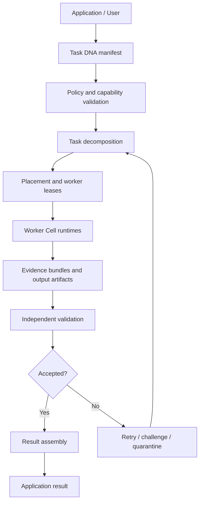

# CellNet Fabric — AWENET Distributed Execution Architecture

**Document type:** Architecture proposal / implementation specification  
**Status:** Proposed; this document does not claim that the described cross-node execution system is implemented.  
**Target:** AWENET core and node product  
**Related systems:** CellKernel local Cell Runtime, AWENET identity/security, discovery/routing, authenticated transport, resource metering, verifier network, storage/replication and founder controls.

## 1. Purpose

CellNet Fabric is the proposed bridge between a computer's local CellKernel runtime and the wider AWENET network. Its goal is to make a participating device contribute selected, explicitly authorized capabilities to a shared network without turning every device into an unrestricted remote shell.

A CellNet workload is a versioned, declarative task package. It describes the requested result, inputs, resource bounds, permitted effects, trust requirements, validation method, and recovery behavior. AWENET may place independent task units on different eligible nodes. Results return as verifiable artifacts, not as untrusted claims.

The intended user experience is simple: a user or application asks for a result; AWENET determines whether it can be safely decomposed, finds suitable resources, runs bounded work, verifies the outputs, and returns a result. The network must remain useful when nodes join, leave, become overloaded, or become unreachable.

This is an architectural direction, not a claim that arbitrary processes can already migrate between devices. The current verifier transport observes network-visible activity and traffic; it does not prove remote CPU/GPU computation. CellNet must add task-specific result verification before any reward or correctness claim is made.

## 2. Design principles

1. **Opt-in contribution:** a node contributes only resources and task classes its owner has explicitly enabled.
2. **Least authority:** a task receives only the capabilities required for its declared effects.
3. **No remote shell:** a task package is not an executable command channel. It is a constrained workload description interpreted by an approved runtime.
4. **Deterministic admission:** every placement decision is explainable from policy, capacity, compatibility, trust and cost inputs.
5. **Verifiable output:** completion is not accepted merely because a worker says it finished.
6. **Bounded operation:** task size, memory, CPU time, messages, retries, storage, dependency depth and execution time have hard limits.
7. **Failure is normal:** node departure, partitions, duplicate messages and partial results are expected conditions.
8. **Privacy by separation:** AWEID, node identity, task identity and public reputation are distinct identifiers and are not automatically disclosed together.
9. **No hidden central scheduler:** coordination may be distributed, while founder authority remains limited to the explicitly documented governance and enrollment functions.
10. **Evidence before rewards:** resource metering, verifier observations and task-result validation are separate evidence classes. A payout policy must state which evidence it consumes.

## 3. Conceptual model

### 3.1 Entities

- **Node:** an AWENET participant with a cryptographic node key, policy, resource advertisement and authenticated transport.
- **Cell:** a bounded runtime unit managed locally by CellKernel or by a compatible worker runtime.
- **Task DNA:** the immutable, versioned manifest that defines one workload and its constraints.
- **Task instance:** one execution of a Task DNA manifest with a unique non-reused identifier.
- **Task unit:** a decomposed, independently schedulable portion of a task.
- **Worker lease:** a time-bounded authorization for one worker to execute one task unit.
- **Evidence bundle:** signed metadata, input/output digests, runtime claims, validation results and provenance.
- **Verifier:** a node or service authorized to evaluate a particular evidence class.
- **Artifact:** content-addressed output stored locally or through AWENET distributed storage.

### 3.2 Control plane and data plane

The control plane handles discovery, admission, leases, capability grants, task state, retries and policy. The data plane transfers bounded inputs and outputs, executes task units and stores artifacts. Control messages must never silently grant data-plane authority.

### 3.3 High-level flow



## 4. Task DNA manifest

Task DNA is a declarative contract, not a script with ambient authority. Its canonical representation should be deterministic CBOR or another explicitly canonical encoding. JSON may be used for human-readable diagnostics but must not be the signature source unless canonicalization is specified.

A first schema proposal:

```text
TaskManifest {
  schema_version: u16,
  task_id: NonZeroU128,
  creator_key_id: KeyId,
  created_at: Timestamp,
  expires_at: Timestamp,
  task_class: TaskClass,
  runtime_abi: RuntimeAbi,
  input_artifacts: [ArtifactRef],
  output_contract: OutputContract,
  decomposition: DecompositionPolicy,
  resource_limits: ResourceLimits,
  capability_request: [CapabilityRequest],
  data_policy: DataPolicy,
  placement_policy: PlacementPolicy,
  validation_policy: ValidationPolicy,
  retry_policy: RetryPolicy,
  payment_policy_ref: Optional<PolicyRef>,
  manifest_digest: Digest,
  creator_signature: Signature
}
```

Required semantic rules:

- `task_id` is unique within the creator namespace and is never reused.
- `expires_at` must be later than `created_at`, within a configured maximum lifetime.
- Every artifact reference includes a digest, size bound, media/type identifier and access policy.
- Every requested capability names a specific operation and scope. Wildcard filesystem, network or device access is forbidden by default.
- The resource budget is a ceiling, not a promise that the worker will receive that amount.
- The output contract defines accepted formats, maximum sizes, required digests and validation rules.
- The manifest signature covers the canonical bytes and all policy-relevant fields.
- Unknown mandatory fields cause rejection. Unknown optional extension fields are preserved but cannot expand authority.
- A worker must reject a manifest whose runtime ABI, task class or validation policy it does not support.

### 4.1 Task classes

Initial task classes should be deliberately narrow:

1. **Pure deterministic function:** input bytes produce output bytes with no external effects.
2. **Map/reduce unit:** independent map tasks and a bounded deterministic reduction.
3. **Media transform:** a constrained decoder/encoder pipeline with strict input and output limits.
4. **AI inference:** model and input artifacts are pinned by digest; model execution is sandboxed; output quality policy is explicit.
5. **Storage maintenance:** integrity scan, replication check or repair proposal; destructive repair requires a separate authorization.
6. **Network measurement:** measures only explicitly authorized network-visible properties; it must not be represented as proof of remote computation.

Arbitrary native binaries, arbitrary scripts and unrestricted user code are out of scope for the first protocol version.

## 5. Task decomposition and dependency graph

A task may be split only when the task class declares a safe decomposition method. The planner creates a directed acyclic graph (DAG) of task units. Each unit has immutable input digests, a bounded output contract and a dependency list.

The planner must verify:
- no dependency cycle exists;
- the graph has bounded node count and depth;
- each unit's input references are available or have an authorized transfer plan;
- each output is consumed only by declared downstream units;
- deterministic tasks use deterministic partitioning and reduction order where required;
- non-deterministic tasks specify a tolerance or challenge-based validation method.

A task unit identifier is derived from the task instance, manifest digest and stable unit path. Replanning must not silently change the meaning of an existing unit ID. A changed plan creates a new plan revision and records why the previous revision was superseded.

## 6. Placement engine

Placement is a policy decision, not a simple "most powerful node wins" ranking.

Candidate evaluation should consider:

- runtime ABI and task-class compatibility;
- owner opt-in and local admission policy;
- available CPU, memory, accelerator, storage and network budgets;
- data locality and transfer cost;
- queue depth and estimated wait;
- node uptime and recent failure rate;
- task-specific trust requirements;
- privacy/data residency restrictions;
- energy/battery policy where available;
- lease duration and deadline feasibility;
- concentration limits so one operator cannot capture every unit.

A deterministic score can be used for ranking, but hard constraints must be evaluated first. A weighted score must never override a failed security, privacy or capability check.

Proposed placement stages:

1. **Filter:** remove nodes failing hard requirements.
2. **Estimate:** compute bounded resource and transfer estimates.
3. **Diversify:** avoid placing all replicas or independent units in one failure domain.
4. **Lease:** issue a signed, short-lived worker lease.
5. **Confirm:** worker acknowledges admission before input transfer begins.
6. **Monitor:** renew or expire the lease based on heartbeat and task policy.

A worker lease binds the task manifest digest, task unit ID, worker node key, granted capability set, resource ceilings, expiry, nonce and allowed artifact references. A lease is not transferable. Renewal creates a new signed lease or a signed extension with monotonic sequence numbers.

## 7. Worker execution contract

A worker must execute a task inside an isolated cell or equivalent sandbox. The runtime receives:
- the immutable manifest and unit descriptor;
- only the authorized input artifacts;
- a lease-bound capability token;
- explicit resource limits;
- a bounded output channel.

The runtime must not inherit ambient credentials, host filesystem access, arbitrary network access, device access or environment secrets. Secret inputs must be separately encrypted for the authorized worker and must not be placed in public discovery records.

The worker lifecycle is:

```text
Discovered -> Eligible -> Leased -> InputsReady -> Running
  -> OutputPrepared -> EvidenceSubmitted -> Accepted | Rejected
  -> Released | Quarantined
```

Every transition is checked against the lease and current task state. A worker that receives a duplicate lease message must behave idempotently. A stale or expired lease cannot restart a task.

## 8. Data Gravity and locality-aware execution

Data Gravity is the placement principle that prefers moving computation to data when doing so is cheaper and safer than moving data to computation.

For each candidate, estimate:

`cost = compute_cost + transfer_cost + storage_cost + privacy_penalty + failure_risk`

All terms must be normalized and documented. The formula is a policy estimate, not an objective truth. Privacy and capability constraints are hard gates, not merely score penalties.

Possible decisions:
- execute near the original artifact;
- use an existing authorized replica;
- transfer a bounded encrypted input to a worker;
- create a temporary replica with a strict retention deadline;
- decline the task if no safe placement exists.

Data Gravity must not silently copy private data to new jurisdictions or nodes. Data owners define allowed regions, node classes, retention and deletion policy.

## 9. Network Organism: adaptive network control

Network Organism is the resilience layer for node churn and changing capacity. It does not mean that the network can rewrite its own security policy.

The network maintains bounded observations:
- peer reachability and authenticated session status;
- advertised capacity with observation timestamp;
- route latency and failure samples;
- task queue pressure;
- replication health;
- verifier availability;
- network partition indicators.

The system may adapt:
- routing preference;
- replica placement proposals;
- task-unit placement;
- retry timing;
- admission throttles;
- relay selection.

It must not autonomously:
- grant new privileges;
- enroll a verifier;
- alter founder authority;
- change reward prices or minting policy;
- weaken signature requirements;
- expand a task's capabilities.

Every adaptive decision records its inputs, policy version, result and expiry. Decisions should be reversible and bounded by a maximum change rate to prevent oscillation.

## 10. Trust Without Identity

Trust evidence and personal identity must be separated.

A node can publish a pseudonymous service identity derived from a public key. It may present task-specific evidence without revealing the user's AWEID. The system must not promise perfect anonymity: network metadata, timing, IP addresses and repeated behavior can correlate activity.

Trust should be represented as scoped evidence, not one universal reputation score:
- transport reliability;
- artifact integrity;
- deterministic task correctness;
- deadline reliability;
- storage durability;
- verifier honesty;
- policy compliance.

Each evidence record includes issuer, subject key, evidence class, observation window, method, confidence/limitations, timestamp, expiry and signature. Evidence from one class must not automatically establish another. For example, a reachable node is not necessarily a correct compute worker.

Reputation aggregation must be resistant to trivial Sybil multiplication. Possible controls include founder-approved verifier enrollment, stake/escrow where appropriate, diverse independent challenges and rate limits. These controls have trade-offs and require a threat-model review before use.

## 11. Evidence and verification

Evidence must be task-specific. The protocol distinguishes:

1. **Transport evidence:** signed observations of network-visible exchange. It can support reachability and traffic claims only.
2. **Execution evidence:** runtime logs, resource counters or platform attestation. These are claims with explicit trust assumptions.
3. **Result evidence:** deterministic recomputation, independent duplicate execution, challenge tests, proof systems or application-specific validators.
4. **Storage evidence:** content digest checks, retrieval challenges and replica availability.
5. **Economic evidence:** policy-approved inputs to settlement. It is not itself a technical proof.

For deterministic tasks, the strongest initial validation is independent recomputation by one or more workers with diverse operators, comparing the output digest. For non-deterministic tasks, define application-specific acceptance thresholds and adversarial test cases. A worker's self-reported CPU/GPU counter is not independent proof.

A result is accepted only when its validation policy passes. If evidence is insufficient, status is `Unverified`, not `Accepted`.

## 12. Retry, recovery and duplicate handling

- Every task unit has an attempt number and a unique attempt nonce.
- A lease expires using bounded clock-skew tolerance.
- A worker cannot submit two different accepted outputs for the same attempt.
- A retry creates a new attempt; it does not erase prior evidence.
- Late outputs are retained as late evidence but cannot overwrite an accepted result.
- Result assembly is idempotent and keyed by task ID, plan revision and output contract.
- If a worker disappears, the scheduler waits for lease expiry or explicit revocation before reassignment, unless the task class explicitly allows speculative duplicate execution.
- Cancellation is a signed state transition. Workers must stop at safe checkpoints and report whether external effects occurred.

## 13. Security and threat model

Threats include malicious workers, malicious task creators, Sybil nodes, compromised verifier keys, replayed leases, manifest substitution, artifact poisoning, resource exhaustion, timing attacks, traffic correlation, network partitions and compromised host kernels.

Required defenses:
- canonical manifest encoding and signature validation;
- nonces, sequence numbers, expiry and replay cache;
- strict size and depth limits on every network message;
- capability-scoped input/output access;
- sandboxing and host resource quotas;
- content-addressed artifacts and digest verification;
- independent validation and failure-domain diversity;
- key revocation and verifier retirement;
- audit logs that are append-only within the node's persistence model;
- explicit privacy and retention policy;
- fail-closed handling of unknown mandatory protocol versions.

A malicious host can falsify its own local resource counters. Remote peers must not treat them as proof. A compromised CellKernel can compromise tasks running on that host; network-level verification cannot magically repair a compromised trusted computing base.

## 14. Protocol and API boundaries

Suggested protocol namespaces (provisional; reserve only after checking existing stream IDs and message registry):

- Task manifest publication and lookup;
- worker capability advertisement;
- lease offer / accept / renew / revoke;
- task-unit input availability;
- output artifact announcement;
- evidence submission / challenge / response;
- task state synchronization.

Do not assign numeric stream IDs in this document. The implementation must inspect the existing stream registry and default allow-list, then reserve IDs centrally to avoid collisions.

Suggested internal Rust boundaries:

```rust
trait TaskValidator {
    fn validate_manifest(&self, manifest: &TaskManifest) -> Result<ValidatedManifest, TaskError>;
    fn validate_result(&self, task: &ValidatedManifest, evidence: &EvidenceBundle)
        -> Result<ValidationDecision, TaskError>;
}

trait PlacementPolicy {
    fn evaluate(&self, task: &ValidatedManifest, candidates: &[NodeOffer])
        -> Result<Vec<PlacementCandidate>, PlacementError>;
}

trait WorkerRuntime {
    fn admit(&mut self, lease: &WorkerLease) -> Result<WorkerHandle, RuntimeError>;
    fn poll(&mut self, handle: WorkerHandle) -> Result<WorkerEvent, RuntimeError>;
    fn cancel(&mut self, handle: WorkerHandle) -> Result<(), RuntimeError>;
}
```

These are interface sketches, not existing APIs.

## 15. Integration with current AWENET modules

| Existing area | Proposed responsibility | Boundary |
| --- | --- | --- |
| Identity / crypto | Sign manifests, leases and evidence | AWEID is not exposed by default |
| Discovery / routing | Find peers and deliver bounded messages | Discovery is not authorization |
| Policy / firewall | Allow only registered protocol messages | Unknown streams remain denied |
| Storage / replication | Store inputs, outputs and evidence artifacts | Digest verification required |
| Resource meter | Local capacity and contribution telemetry | Counters are not remote compute proof |
| Verifier network | Verify scoped evidence classes | Existing transport observation remains transport evidence |
| Founder controls | Manage verifier enrollment and global governance | No hidden task execution privilege |
| ONECOIN economy | Consume accepted settlement evidence | No payout before policy validation |
| Product facade | Expose task, worker and health status | Facade does not bypass subsystem checks |

## 16. Rollout plan

### Phase A — Specification and local simulator
- Define canonical manifest schema and test vectors.
- Define task state machine and lease rules.
- Build a deterministic in-process simulator with fake nodes.
- Test malicious manifests, duplicate messages, expired leases and resource exhaustion.
- No network execution and no payments.

### Phase B — Local sandbox worker
- Run only deterministic, pure-function tasks.
- Use a local worker cell and explicit input/output artifacts.
- Add hard CPU, memory, wall-clock and output limits.
- Validate results by independent local recomputation.
- Record all evidence and resource counters with their limitations.

### Phase C — Two-node experimental network
- Add authenticated peer messages and short-lived leases.
- Execute a harmless deterministic test task across two opt-in nodes.
- Test disconnects, replay, duplicate submissions and key revocation.
- Keep economic settlement disabled.

### Phase D — Multi-node validation
- Add failure-domain-aware placement and independent recomputation.
- Add challenge/response and verifier policy.
- Run adversarial tests and network partitions.
- Publish benchmark and failure reports.

### Phase E — Controlled product integration
- Expose user-facing task creation and worker opt-in.
- Add storage retention and privacy controls.
- Enable rewards only after an explicit, audited settlement specification and fraud review.

## 17. Acceptance criteria

A milestone is complete only when:
- the manifest has canonical encoding, signature test vectors and strict validation;
- leases are bound to task, unit, worker, capability scope and expiry;
- duplicate and replay tests pass;
- worker resource limits are enforced by the runtime, not just declared;
- no task can access undeclared files, secrets, network or devices;
- task results are validated independently according to task class;
- worker departure and retry are deterministic and auditable;
- protocol messages are bounded and default-denied unless explicitly allowed;
- no ONECOIN reward is triggered by transport traffic alone;
- CI, fuzz tests and integration tests provide reproducible evidence.

## 18. Explicit non-goals and open questions

- This design does not provide arbitrary process migration or transparent migration of live memory.
- It does not make an untrusted host trustworthy.
- It does not guarantee anonymity.
- It does not prove remote GPU/CPU execution from network traffic.
- It does not replace existing AWENET consensus, identity, storage or founder security.
- It does not define a new cryptocurrency or alter ONECOIN economics.
- It does not promise that every workload can be parallelized.

Open research questions include deterministic WASM/runtime selection, confidential-compute support, privacy-preserving worker discovery, robust non-deterministic output validation, cross-architecture numerical reproducibility, and how to prevent a small number of operators from dominating placement.

## 19. Relationship to CellKernel

CellKernel owns the local execution boundary: cell admission, local capabilities, resource enforcement, process lifecycle, memory isolation and local recovery. AWENET owns remote discovery, leases, artifact exchange, task placement and cross-node evidence. CellNet Fabric is the versioned contract between them.

The boundary must remain explicit: a network peer may request a task, but only the local CellKernel policy may admit it. AWENET cannot override local owner consent or kernel capability checks.
